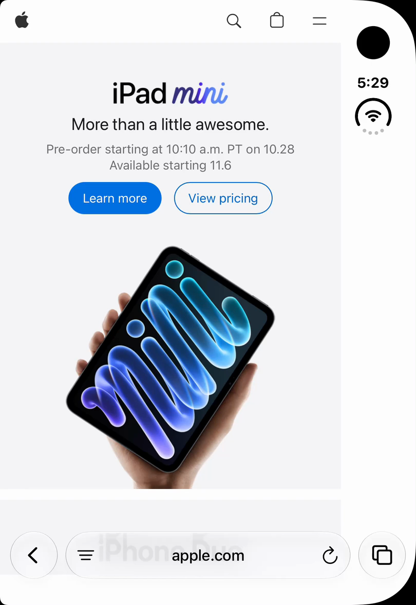
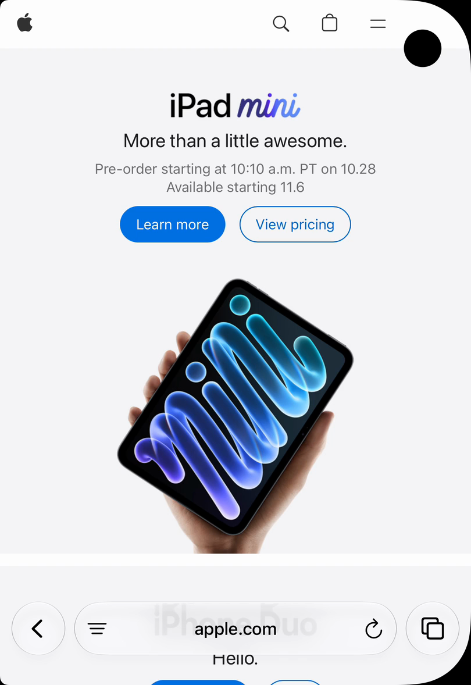

# DuoBrowser

A free, minimal iPhone Duo browser built with SwiftUI, UIKit and WKWebView. DuoBrowser uses the outer display edge to edge and moves small obstructed website controls away from the camera when a safe adjustment is possible.

**No advertising, subscriptions, paid features or app tracking.** Community contributions are welcome; Christopher Nichols retains final authority over merges and official releases.

This is a development preview, not an App Store release. The repository is being prepared for public launch and remains private until the owner approves publication.

## Purpose

Keep the page central, controls reachable, and browsing dependable. Safari-level reliability is the goal, not a claim of parity. Website adaptation is conservative and reversible, and every site can return to Original Layout.

## Features

- Full-width browsing with camera-aware adjustments based on actual system geometry.
- Bottom Liquid Glass controls that shrink into a domain pill while scrolling.
- Normal and private tabs, previews, lazy restoration and a bounded preview cache.
- Local history, bookmarks, find on page and native sharing.
- Downloads to Files, WebKit file/photo selection, guarded external links and JavaScript dialogs.
- Per-site layout and desktop/mobile preferences, system appearance and accessible native controls.

Layout fitting is local and deterministic. There are no AI calls or site-specific repair rules. Ambiguous layouts fall back without alteration; not every website can be repaired safely.

## Screenshots

Apple.com on the closed Duo simulator, showing the same page with standard insets and full-width rendering. These frames come from the recorded development demo; both modes are DuoBrowser, not a comparison with Safari. Website content belongs to its respective owner.

| Standard insets | Full-width DuoBrowser |
| --- | --- |
|  |  |

## Compatibility and requirements

- macOS with **Xcode 27.1**, the iOS 27.1 SDK and an iPhone Duo simulator runtime.
- Deployment target: **iOS 27.1**. Closed, open and partially folded layouts use runtime geometry; they do not require a page reload just because the display changes size.
- Node.js 22 and npm for development-only layout tests. Python 3 and OpenSSL for synthetic native fixtures. SwiftLint 0.65.1 for the checked-in correctness rules.
- No third-party runtime packages, app server, API key or Apple Intelligence requirement.

Signed-device passwords/passkeys, physical permissions/media, full spoken VoiceOver coverage, energy/endurance and authenticated-site compatibility remain release gates. See the [implementation report](docs/PRODUCTION_IMPLEMENTATION_2026-10-27.md) and [iPhone credential checklist](docs/IPHONE_PASSWORD_PASSKEY_CHECKLIST.md).

## Build locally

```sh
git clone https://github.com/cnichols1734/DuoBrowser.git
cd DuoBrowser
open DuoBrowser.xcodeproj
```

Choose the **DuoBrowser** scheme and a Duo simulator, then Run. No signing team is needed for the simulator. From the repository root:

```sh
xcodebuild -project DuoBrowser.xcodeproj -scheme DuoBrowser \
  -configuration Debug -destination 'generic/platform=iOS Simulator' \
  -derivedDataPath DerivedData CODE_SIGNING_ALLOWED=NO build
```

Use a separate test simulator and synthetic data. Do not commit personal signing settings or change the shared bundle identifier for your local account.

```sh
bash scripts/check.sh
npm ci --ignore-scripts
npx --no-install playwright install chromium
npm test
swiftlint lint --strict --config .swiftlint.yml
bash scripts/native-checks.sh
```

The native script creates a disposable Duo simulator, runs isolated WebKit/persistence/memory checks, and removes that simulator afterward. [Test details and manual checks](Tests/README.md) distinguish portable tests, native evidence and hardware gaps.

## Architecture

| Layer | Responsibility |
| --- | --- |
| SwiftUI shell | Bottom controls, tab overview, local library and accessibility |
| UIKit / WKWebView | Page rendering, navigation, permissions, downloads and display geometry |
| BrowserSession / BrowserModel | Tab ownership, normal/private stores, lifecycle and recovery |
| BrowserData / TabArchive | Bounded local history/preferences and best-effort session restoration |
| PageLayout.js / CameraAvoidance.js | Bounded geometry checks, safe page adjustments and rollback |

Normal browsing uses persistent WebKit storage. Private tabs share a separate nonpersistent store until all private tabs close; their URLs, history, previews and site preferences are not archived. Deliberately saved bookmarks and Files exports are exceptions. Cold restart restores URLs and best-effort scroll positions, not form values or full back/forward history.

## Security and privacy

The app contains no analytics or advertising SDKs and sends no page content to an AI service. Websites and search destinations still receive ordinary browsing requests and may track visitors. Private mode does not anonymize network traffic.

Page content is untrusted. Adaptation must preserve forms, focus, navigation and accessibility, and remain reversible. Code signing and App Store submission are separate, owner-authorized steps. Report vulnerabilities privately using [SECURITY.md](SECURITY.md).

## Contribute

Start with [CONTRIBUTING.md](CONTRIBUTING.md), choose an issue or propose a focused improvement, and submit a PR. All changes require review; submitting a PR or passing CI does not guarantee acceptance. Follow the [code of conduct](CODE_OF_CONDUCT.md). [RELEASING.md](RELEASING.md) describes the owner's release control.

Project context: [product brief](docs/PRODUCT_BRIEF.md), [architecture](docs/ARCHITECTURE.md), [roadmap](docs/ROADMAP.md), [accessibility and memory findings](docs/ACCESSIBILITY_MEMORY_2026-10-27.md).

## License

Project-owned code, documentation and artwork are available under the [MIT License](LICENSE), copyright 2026 Christopher Nichols. [Third-party notices](THIRD_PARTY_NOTICES.md) identify separately licensed material and development tools. Apple and website names remain their respective owners' trademarks; no affiliation or endorsement is implied.
