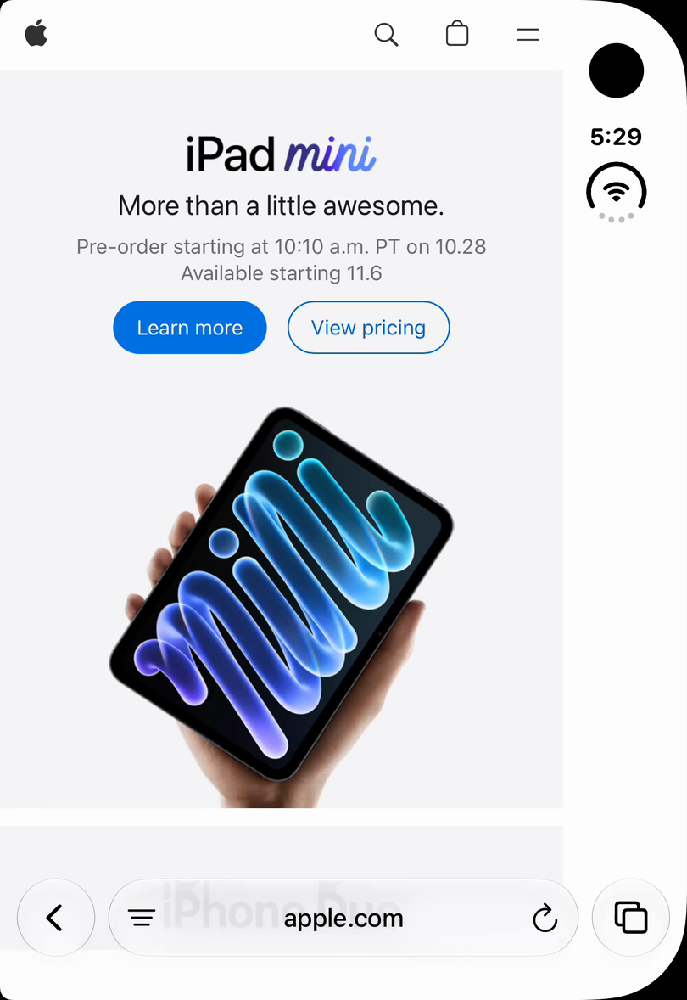
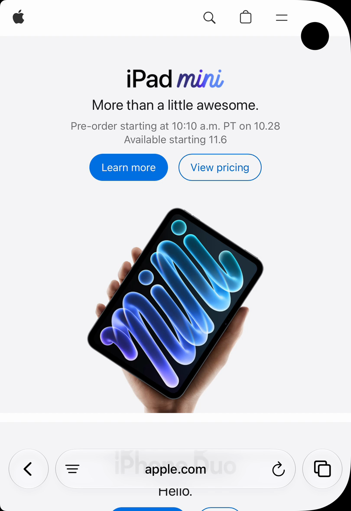

# DuoBrowser

A free, minimal iPhone Duo browser built with SwiftUI, UIKit and WKWebView. DuoBrowser uses the outer display edge to edge and moves obstructed reading blocks and small website controls away from the camera when a safe adjustment is possible.

**No advertising, subscriptions, paid features or app tracking.** Community contributions are welcome; Christopher Nichols retains final authority over merges and official releases.

This is a development preview, not an App Store release. Contributions go through pull requests, and official releases remain owner-controlled.

## Purpose

Keep the page central, controls reachable, and browsing dependable. Safari-level reliability is the goal, not a claim of parity. Website adaptation is conservative and reversible, and every site can return to Original Layout.

## Features

- Optional first-run walkthrough with setup reentry from Page options. Direct Safari transfer integration is prepared with category selection and review before saving; activation awaits Apple’s Default Web Browser approval. No file-export/import workflow. See [status and requirements](docs/SAFARI_TRANSFER.md).

- Full-width browsing with camera-aware adjustments based on actual system geometry. Page options includes **Time, Signal & Battery**, a remembered on/off control.
- Stable text while scrolling, followed by a gentle sideways adjustment to fit beside the camera after scrolling stops.
- Bottom Liquid Glass controls that shrink into a domain pill while scrolling.
- Normal and private tabs, previews, lazy restoration and a bounded preview cache. Normal tabs include Undo and a 20-item Recently Closed list; reopening restores the saved address and best-effort reading position, not page input or navigation history. Drag the address capsule to preview and switch adjacent tabs without reloading. The overview has visible search, remembered Grid/List layouts, reordering and multi-select move/close. Hold Back for previous pages in the current tab.
- Unified local search across tabs, bookmarks and history, with private-search isolation.
- Named workspaces and pinned tabs, with normal-session restoration. The redesigned start page has a workspace switcher, direct search, editable Favorites, and shortcuts back to existing tabs. Sections are configurable; recent sites are optional. Private browsing has a separate start page without normal tabs, favorites or history.
- Native Page options groups Share, Save, Find and the existing Reader together, with website controls and browser destinations below. Connection failures have explicit recovery actions; usable pages remain visible, and recovery never automatically resubmits a form.
- A shared start-page/tab-switcher wallpaper and locally saved background tint.
- Start-page shortcuts show site icons with a letter fallback. Icons prefer high-resolution touch icons discovered from each site’s public home page, with `/favicon.ico` as a fallback (including secure CDN redirects). Saved browsing paths, cookies and credentials are excluded; bounded downloads and the icon cache stay in memory. Private start pages do not load these shortcuts.
- Native floating link previews that can become tabs without reloading.
- Full-width, camera-aware Reader with ordered article photos, captions, typography and appearance controls.
- Maintained EasyList/EasyPrivacy ad and tracker filters, supported cosmetic ad hiding, optional cookie-notice filtering, automatic updates with a working fallback, and per-site exceptions. Filter credits and licenses are available in the app.
- Local history, editable bookmarks and folders, Favorites, and a Reading List with read/unread filtering. Save readable articles for offline use with bounded local image copies; Reader remembers text size, spacing and appearance.
- Find on page and native sharing.
- Downloads panel with progress, individual cancel/retry, native preview and Save to Files. Completed normal downloads survive tab closure and relaunch; private downloads remain temporary until explicitly exported. WebKit file/photo selection, guarded external links and JavaScript dialogs.
- Settings includes a global **Block Ads & Trackers** switch, setup guidance for other apps’ system-wide filtering, and a **Reddit** link preference. Installed Safari extensions are not imported or hosted. Tapped Reddit content links can open in an installed Apollo Reborn, with a remembered first choice, Ask Every Time, browser fallback, and confirmation in private tabs. Artemis is pending a verified deep-link contract. See [coverage and verification](docs/REDDIT_LINKS_AND_BLOCKING.md).
- Per-site layout and desktop/mobile preferences, system appearance and accessible native controls.

Layout fitting is local and deterministic. There are no AI calls or site-specific repair rules. Ambiguous layouts fall back without alteration; not every website can be repaired safely.

See the [upgrade guide and limitations](docs/BROWSER_UPGRADES_2026-10-29.md) for coverage and privacy details.

## Screenshots

Apple.com on the closed Duo simulator, showing the same page with standard insets and full-width rendering. These frames come from the recorded development demo; both modes are DuoBrowser, not a comparison with Safari. Website content belongs to its respective owner.

| Standard insets | Full-width DuoBrowser |
| --- | --- |
|  |  |

## Compatibility and requirements

- macOS with **Xcode 27.1**, the iOS 27.1 SDK and an iPhone Duo simulator runtime.
- Deployment target: **iOS 27.1**. Closed, open and partially folded layouts use runtime geometry; they do not require a page reload just because the display changes size.
- Node.js 22 and npm for development-only layout tests. Python 3 and OpenSSL for synthetic native fixtures. SwiftLint 0.65.1 for the checked-in correctness rules.
- No third-party runtime packages, app server, API key or Apple Intelligence requirement.

Signed-device passwords/passkeys, physical permissions/media, full spoken VoiceOver coverage, energy/endurance and authenticated-site compatibility remain release gates. See the [implementation report](docs/PRODUCTION_IMPLEMENTATION_2026-10-27.md) and [iPhone credential checklist](docs/IPHONE_PASSWORD_PASSKEY_CHECKLIST.md).

## Build locally

```sh
git clone https://github.com/cnichols1734/DuoBrowser.git
cd DuoBrowser
open DuoBrowser.xcodeproj
```

Choose the **DuoBrowser** scheme and a Duo simulator, then Run. No signing team is needed for the simulator. From the repository root:

```sh
xcodebuild -project DuoBrowser.xcodeproj -scheme DuoBrowser \
  -configuration Debug -destination 'generic/platform=iOS Simulator' \
  -derivedDataPath DerivedData CODE_SIGNING_ALLOWED=NO build
```

Use a separate test simulator and synthetic data. Do not commit personal signing settings or change the shared bundle identifier for your local account.

```sh
bash scripts/check.sh
npm ci --ignore-scripts
npx --no-install playwright install chromium
npm test
swiftlint lint --strict --config .swiftlint.yml
bash scripts/native-checks.sh
```

The native script creates a disposable Duo simulator, runs isolated WebKit/persistence/memory checks, and removes that simulator afterward. [Test details and manual checks](Tests/README.md) distinguish portable tests, native evidence and hardware gaps.

## Architecture

| Layer | Responsibility |
| --- | --- |
| SwiftUI shell | Bottom controls, tab overview, local library and accessibility |
| UIKit / WKWebView | Page rendering, navigation, permissions, downloads and display geometry |
| BrowserSession / BrowserModel | Tab ownership, normal/private stores, lifecycle and recovery |
| BrowserData / TabArchive | Bounded local history/preferences and best-effort session restoration |
| PageLayout.js / CameraAvoidance.js | Bounded geometry checks, safe page adjustments and rollback |

Normal browsing uses persistent WebKit storage. Private tabs share a separate nonpersistent store until all private tabs close; their URLs, history, previews and site preferences are not archived. Deliberately saved bookmarks and Files exports are exceptions. Cold restart restores URLs and best-effort scroll positions, not form values or full back/forward history.

## Security and privacy

The app contains no analytics or advertising SDKs and sends no page content to an AI service. Websites and search destinations still receive ordinary browsing requests and may track visitors. Private mode does not anonymize network traffic.

Page content is untrusted. Adaptation must preserve forms, focus, navigation and accessibility, and remain reversible. Code signing and App Store submission are separate, owner-authorized steps. Report vulnerabilities privately using [SECURITY.md](SECURITY.md).

## Contribute

Start with [CONTRIBUTING.md](CONTRIBUTING.md), choose an issue or propose a focused improvement, and submit a PR. All changes require review; submitting a PR or passing CI does not guarantee acceptance. Follow the [code of conduct](CODE_OF_CONDUCT.md). [RELEASING.md](RELEASING.md) describes the owner's release control.

Project context: [product brief](docs/PRODUCT_BRIEF.md), [architecture](docs/ARCHITECTURE.md), [roadmap](docs/ROADMAP.md), [accessibility and memory findings](docs/ACCESSIBILITY_MEMORY_2026-10-27.md).

## License

Project-owned code, documentation and artwork are available under the [MIT License](LICENSE), copyright 2026 Christopher Nichols. [Third-party notices](THIRD_PARTY_NOTICES.md) identify separately licensed material and development tools. Apple and website names remain their respective owners' trademarks; no affiliation or endorsement is implied.

### Address suggestions

Searches from the start page and address bar use your chosen engine: Google (default), DuckDuckGo, Bing or Brave Search in Settings. Settings also contains appearance, system status, setup, privacy and link preferences. Clear Browsing Data offers separately confirmed history, cookies/site data and cache removal; Website Data removes actual WebKit domain groups from the normal profile while preserving bookmarks and downloaded files. Typing a known website prefix completes the address inline with the remaining suffix selected (`g` → `www.google.com`); continuing to type replaces that suffix, while Backspace dismisses it. The top website match remains above Google keyword predictions, local tabs, bookmarks and history. Predictions use the keyword you typed, not the completed domain. When Google is selected and Online Search Suggestions is enabled in Settings, plain search text is sent to Google as you type; URLs, private-tab input and unfinished keyboard composition are excluded. Requests use an ephemeral session without shared cookies or a disk cache. Website matches remain available offline. The bundled website list is curated, not a live popularity chart.
