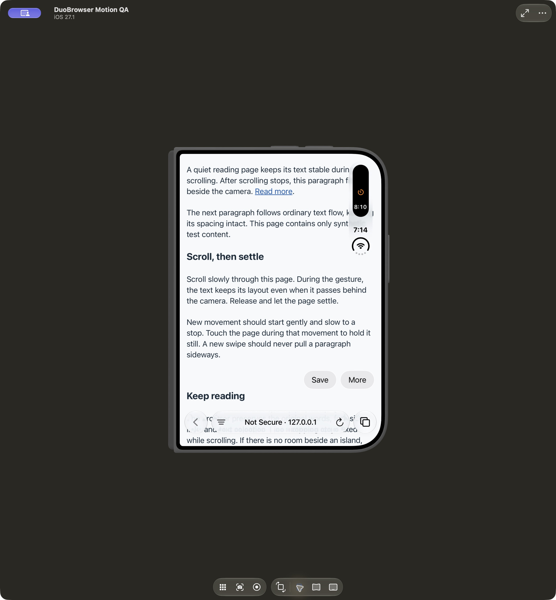
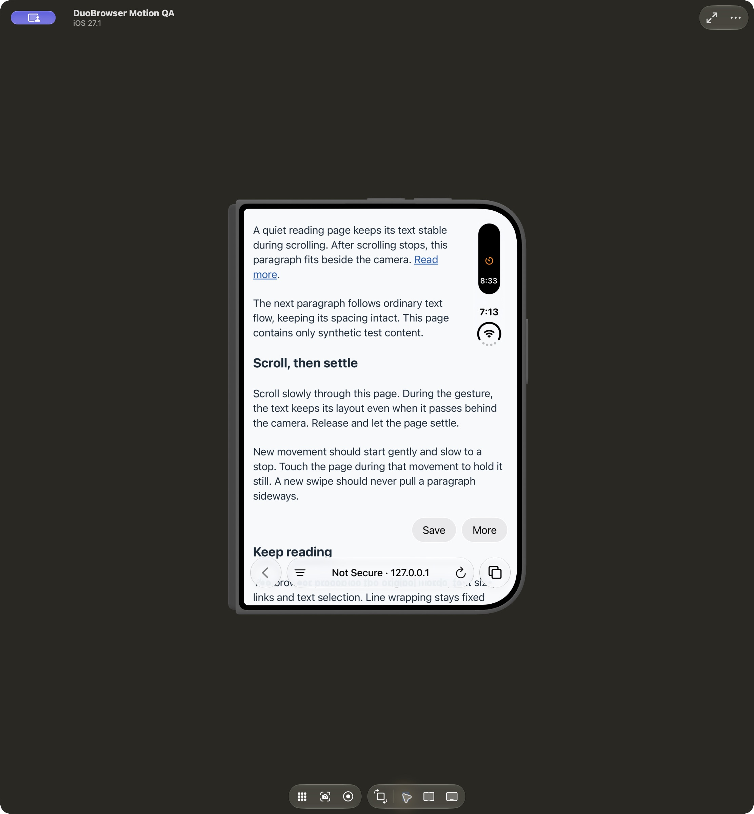
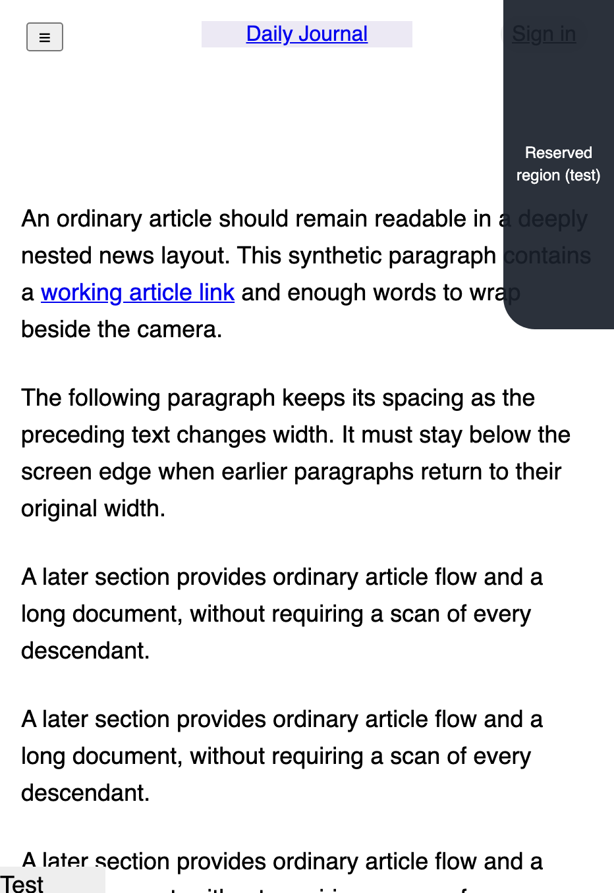
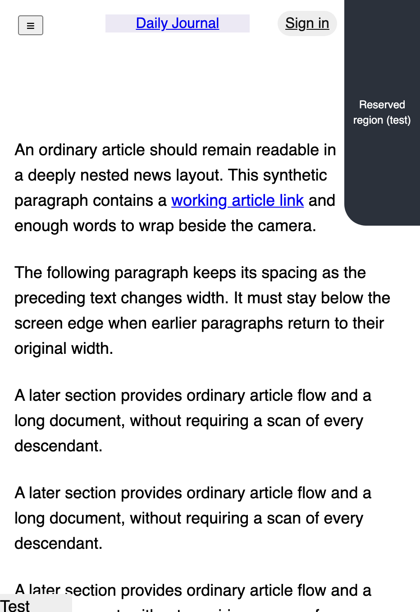

# Sideways scroll settling — October 28, 2026

The owner requested stable text while scrolling, followed by a very smooth correction **to the side** of the camera. The affected paragraph keeps its top position. There is no added gap above it and no vertical text-avoidance fallback.

The implementation waits for touch release and 240 ms without a scroll event, then uses a 420 ms ease-out horizontal transform. Small controls and short text move into verified free horizontal space. A supported full-width reading block can narrow inward from the obstructed edge, with one reflow after the pause and a subtle opacity transition. Its font size and actual DOM stay intact; glyphs are never scaled. Following paragraphs keep their ordinary gap and may move by the natural text-height change. Starting another gesture freezes the current presentation and defers further fitting.

The remaining text width must be at least 180 CSS pixels and 60% of the original. The maximum width reduction is 180 pixels. A large expanded island spanning nearly the full viewport has no useful horizontal destination, so fitting falls back instead of pushing content down. Editing, selected text, fullscreen and pinch zoom defer fitting. Original Layout restores the author's styles. Reduce Motion removes animation; VoiceOver keeps reading blocks in their original layout.

This original implementation follows the requested interaction and a review of `hyungchulc/duowide` at `7070b4da2a419a102fc9e3d942a1e756453d7ac9e`. It remains local, deterministic and isolated. No runtime dependency, model call, persistence, page-content telemetry or new native bridge was added.

## Automated evidence

- Xcode 27.1 / iOS 27.1: Debug and Release simulator builds succeeded.
- `scripts/check.sh`: 21 scrolling, 12 archive and 19 browser-data assertions, syntax and repository-policy checks passed.
- `npm test`: 25 gutter, 14 control-avoidance and 50 sideways-settling checks. The new suite explicitly checks no vertical movement of the affected paragraph, no glyph scaling, stable line wrapping during scrolling, both camera sides, partly visible paragraphs and fallback for a full-width island.
- SwiftLint 0.65.1: zero violations across 22 Swift files.
- Final native run passed: 22 sideways-settling assertions in the exact bundled WKWebView content world, 30 browser checks, three cross-process persistence checks and 11 memory checks. The follow-up run uses the Debug build with visible reading-position anchoring.
- An earlier broad run timed out waiting for a reclaimed tab's scroll position. An unchanged rerun passed. No unrelated restoration change was made; this intermittent result remains recorded.

Convergence checks caught a stylesheet `load` event scheduling another adjustment. The listener excludes the adapter's own sheet. Destination checks also reject otherwise-empty overlays that would intercept taps.

## Simulator review

Dedicated simulator: **DuoBrowser Motion QA**, iPhone Duo, iOS 27.1. The initial fixture review used only synthetic page content and drafts. A later owner-reported live news layout was inspected locally; no live article content or screenshots are checked in. The existing DuoBrowser QA simulator and its data were preserved.

The runtime has no Clock app, so the separate `Tests/IslandLab` ActivityKit app provides a real timer Live Activity. Its generated project and products stay in ignored `work/`; it is not in DuoBrowser's shipping target. Enable **Page options → Developer → Show system status** to display it while retaining a full-width web view. The switch is Debug-only and session-local; Release keeps its existing status-area policy. Press and hold the compact island to expand it.

| Original Layout | Sideways fitting after the pause |
| --- | --- |
|  |  |

These captures show the real system Live Activity and status rail. The paragraph starts at the same vertical position and retains its font size. A following paragraph may move by the extra line height from narrowing; no blank avoidance gap is inserted above the affected paragraph.

| Interaction | Result and scope |
| --- | --- |
| Compact Live Activity and Original Layout toggle | Visually checked: text fits inward from the right camera edge; restoring the original layout returns text behind it. |
| Closed, partially open and open poses | Visually checked on the synthetic page. The layout follows the viewport and system region. |
| Form and keyboard | Typed a synthetic draft, displayed and dismissed the software keyboard, folded/opened/rotated, and confirmed the draft remained. |
| Scroll interruption and momentum | Forward and reverse native drags were checked with fitting enabled and Original Layout. The page passes behind the island during motion and fits beside it after stopping. Chromium and bundled WKWebView assertions additionally check fixed line wrapping during movement, interruption and horizontal intermediate animation frames after release. |
| Enlarged/removed occlusion | Native and Chromium geometry fixtures check sideways recomputation, original-width restoration, and full-width fallback without a vertical shift. Actual compact/expanded Live Activity UI was opened and collapsed through Island Lab. The expanded system card overlays the page; the bounded sideways algorithm does not try to create vertical space beneath a full-width card. |
| Reduce Motion / VoiceOver | Native flags and browser fixtures check immediate post-pause fitting and unchanged VoiceOver reading blocks. Spoken VoiceOver interaction remains unverified. |
| Selection, focus and zoom | Automated deferral and draft-preservation checks pass. Manual two-finger pinch and larger-text coverage remain open. |

## Reading-position follow-up

The owner reproduced text moving up and out of view while it fitted sideways. A synthetic reproduction confirmed a paragraph at **y = 8 px** settled at **y = -16 px**: removing an earlier, offscreen paragraph's narrowing shortened the content above it by 24 pixels. Preserving the numeric scroll offset did not preserve the text's screen position.

The transaction now anchors the first visible reading block before restoring old styles. For a partially visible paragraph, it anchors a real visible character so line wrapping above the viewport cannot lose the reading position. The scroll correction is synchronous, ignores author smooth-scroll CSS and is excluded from user-scroll interruption handling. The anchored text's animation uses horizontal displacement only. Corrections are bounded and rolled back if a document edge or a newly obstructed destination prevents a safe fit.

New browser regressions sample every animation frame for the 8 px reproduction, offscreen cleanup, reverse scrolling, convergence, smooth-scroll CSS, and a visible word during narrowing/restoration. The native harness includes the same paragraph and visible-word cases. Follow-up validation passed: Debug and Release builds; 89 Chromium layout checks; 52 portable assertions and strict SwiftLint; and the full native run (30 browser, 22 settling, three persistence and 11 memory checks). Native frame assertions compare the actual pre-settle text position with less than one CSS pixel of tolerance for WebKit scroll quantization. On the installed build, the synthetic Read more link placed its heading at the viewport top; the heading remained visible after preceding paragraphs were restored and adjacent text fitted sideways. Native scrolling was also exercised with the real compact activity visible. The earlier hosted CI run failed while waiting for the fixture server to start, before native assertions; the updated PR triggers a fresh run.

## Nested news layout follow-up

The live news article exposed gaps that the original fixtures missed: a sticky header, a closed offcanvas drawer inside that header, deeply nested grid shells, and a large stationary section above the current paragraph. These made the engine fall back even where a safe sideways adjustment was possible.

The engine now supports local block flow through at most 24 ancestors, checking at most 192 sibling elements. Visible movable siblings animate; stationary or offscreen sections are checked without walking and transforming their entire subtrees. A complex following section can move by the measured natural line-height growth without being transformed, preserving embedded fixed controls. This may reposition an ad or complex section immediately after the pause; the reading text still animates smoothly. Shell widths, paragraph gaps, sibling geometry and document growth are validated before retaining a fit. Direct grid text, transformed/clipped reading containers, and unsupported changes still fall back.

A compact flex/grid control row can reclaim up to 120 pixels of width while retaining at least 60%. Every visible action must retain its size and vertical position, remain tappable, and avoid both other controls and reserved regions. Closed offcanvas panels must keep their geometry. Only individual actions animate, so the header's fixed descendants retain their containing block. Repeated settling retains the row's visible actions as candidates. Existing sticky page bars are excluded when choosing the real visible character to anchor. Completely hidden paragraphs are not fitted: fitting one could create a new visible line, then anchor compensation would hide it again and roll back the visible paragraph too. A dedicated regression covers this live post-scroll case.

The rebuilt app was inspected on the same live article with the real compact Live Activity and status rail. The header logo/sign-in controls and the colliding article paragraph fitted to the side; the header stayed fitted through a native swipe. The temporary CSS-only investigation was removed from the app and its local cache deleted. No site-specific selectors, article content, browsing export or telemetry were added.

`NestedNewsTests.cjs` adds thirteen regressions using an original synthetic news fixture: nested grid shells, a large offscreen drawer, unchanged drawer geometry, header and article links, repeated settling, restoration, subsequent scrolling and visible-word anchoring below sticky chrome. All 102 Chromium checks and the 30 native WebKit settling assertions pass, including the eight new nested-layout assertions. The broader native run passed 30 browser, three persistence and 11 memory checks. Debug and Release builds, 52 portable assertions and strict SwiftLint also pass. The first new native-fixture attempt exposed a test-server route error; correcting that route allowed the complete settling suite to run.

| Original layout — synthetic geometry | Fitted header and article — synthetic geometry |
| --- | --- |
|  |  |

These two captures are Chromium fixture renders with a labelled test region, not screenshots of system island geometry or a live article.

The preceding hosted CI run (`40801254953`) failed in the general native browser harness, before settling tests. Its log did not include the failed assertion. The test script now prints its bounded synthetic failure receipt to make future CI failures diagnosable; no checks are skipped or weakened.

## Remaining limits

Unsupported transformed/clipped/complex layouts stay original. Some content can remain behind an occlusion when there is insufficient space beside it. A broader website corpus and authenticated flows remain open. Responsive fold/rotation changes can naturally rewrap pages; the guarantee is stable layout during scrolling, not identical line breaks at every viewport size.

Simulator evidence does not establish physical-device touch quality, steady 60/120 fps, battery impact, spoken VoiceOver behavior or hardware accessibility. Those remain release gates. The expanded test island is real system UI; synthetic geometry checks are identified separately and do not prove all iOS geometry reporting.

Reproduction: [browser tests](../Tests/README.md), [Live Activity companion](../Tests/IslandLab/README.md), and the loopback `/settling` page. Raw logs, receipts, screenshots and recordings stay under ignored `work/settling/`; selected synthetic UI evidence is checked in.
