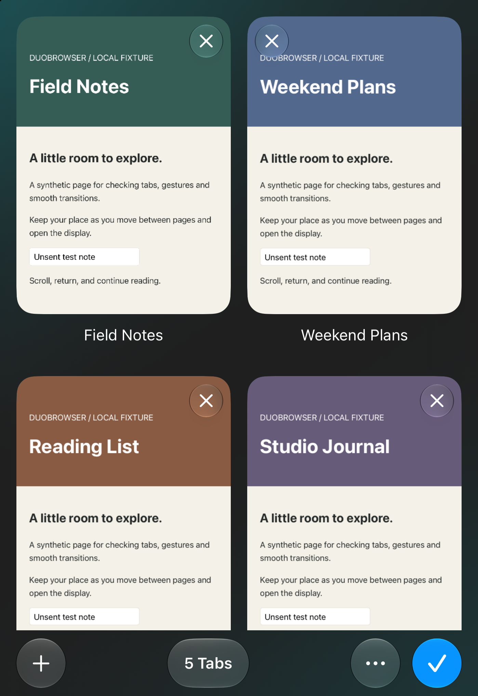

# Full-screen tab overview

The November 8 owner reference calls for Safari-style previews over a glass wallpaper, full display width, bottom controls and left-swipe/X closing. The follow-up requires a continuous zoom from the live page to its preview and back. This change uses public UIKit transitions; it does not reproduce Safari private code or claim exact parity.

- `BrowserZoomPresenter` reclaims container space before embedding its overview host. `TabStackController` now owns a vertical collection grid, hit testing and leftward dismissal. Its historical name is retained to avoid unnecessary project-file churn.
- The transition source is the rounded page preview, with the title outside the zoom rectangle. New tab, selection, Done and return to overview keep existing session ownership. No replacement web view or page reload is introduced by the transition.
- The collection gives vertical gestures to scrolling and accepts deliberate leftward card drags. Short drags return; reversal cancels. Closing and teardown remain exactly-once operations, including during filtering/reuse.
- Close controls use actual window occlusion frames. Bottom controls use the same bounded runtime clearance policy as browsing. The grid does not reserve a full-height camera rail or infer device pose from width.
- PhotosPicker imports only the chosen photo into a bounded local wallpaper. A material overlay softens it behind tabs. Reduce Transparency uses an opaque overview background. The app cannot automatically inherit the system Home Screen wallpaper; choose the same image through **Tab options → Tab Appearance → Choose Photo** if desired.

## Verification

- Xcode 27.2 (27B52); iOS 27.1 simulator. Deployment target remains iOS 27.1.
- Debug and Release simulator builds; signed Release device build and code-signature verification passed.
- `scripts/check.sh`: 21 scrolling, 12 archive, 29 data-policy and 33 address-suggestion assertions; parsing/repository checks passed.
- `npm test`: 25 page layout, 44 Reader, 14 camera avoidance, 71 settling and 13 nested-news assertions passed.
- SwiftLint: no violations.
- After the final gesture/hosting fixes, Debug and Release simulator builds and the signed Release device build passed again; the focused native grid/zoom suite passed 18 assertions. Development build 4 was installed and launched on the connected iPhone Duo (iOS 27.3). This is a local device installation, not a TestFlight or App Store release.
- The complete native suite passed: grid/zoom, 46 core browsing, 55 upgrade, 34 settling, 2 cookie-write, 2 cookie-relaunch and 11 memory assertions.
- Native grid tests cover two columns, nonoverlapping cards, exact preview zoom bounds, uninterrupted leftward exit, exactly-once close/filter/teardown, resize, wide-grid visibility, Reduce Motion and live-web-view identity across transitions.

Device Hub interaction checks used the committed `--tab-overview-demo` synthetic fixture: page-to-card and card-to-page native zoom, fast left swipe (five tabs to four), X close (four to three), vertical scrolling without closing, search filtering/cancel and keyboard presentation. Closed, partially open, open and rotated simulator layouts were visually checked. The per-card hosting controller also disables container safe areas so the rightmost previews fill their cards rather than retaining a camera-side inset.

Photo-picker import, spoken VoiceOver, maximum Dynamic Type and live system-occlusion changes were not manually exercised for this change. Physical touch smoothness, sustained frame pacing, battery use, spoken VoiceOver and expanded Live Activity transitions remain hardware acceptance work. Simulator animation and layout tests do not establish these properties.
