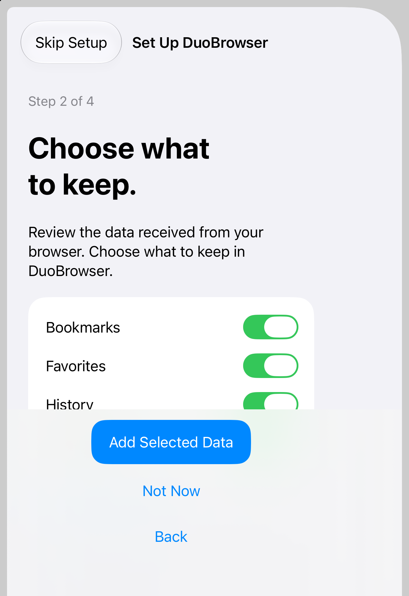
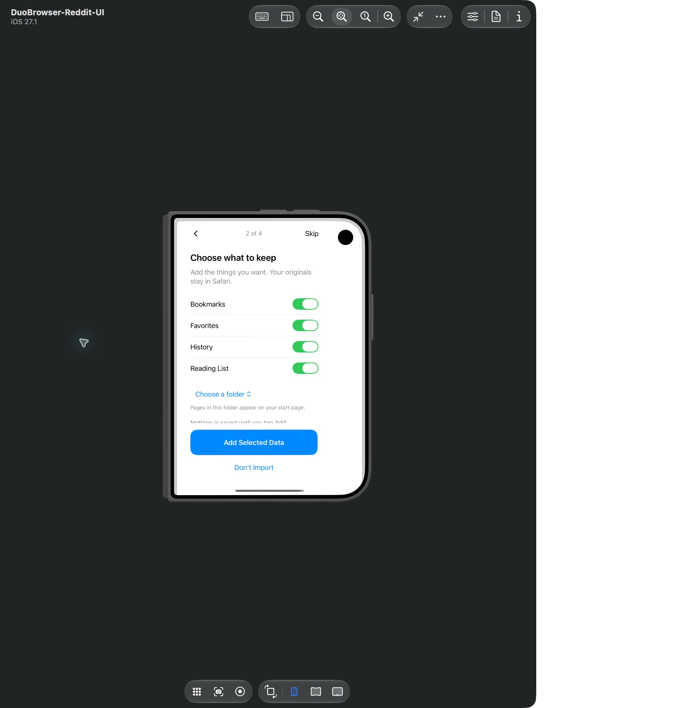
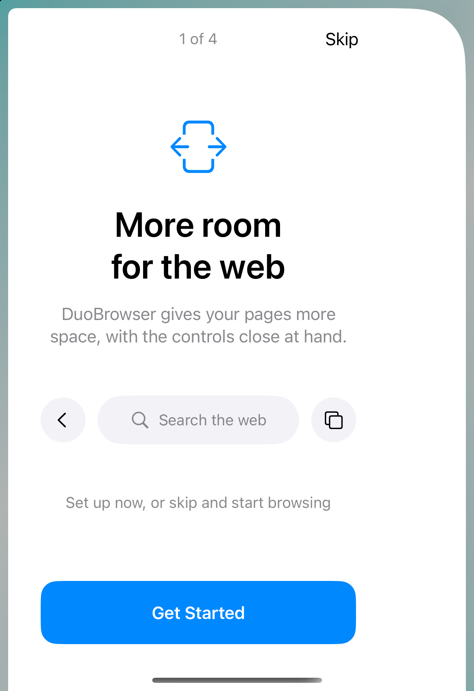
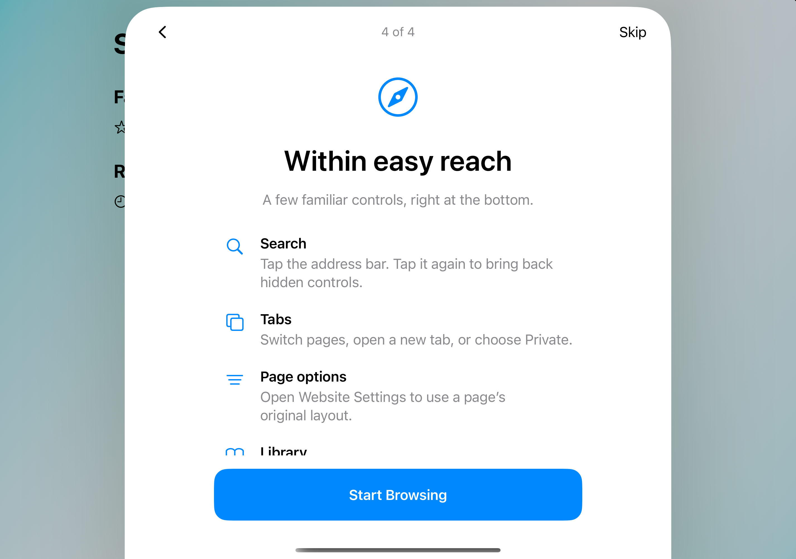

# Onboarding redesign — November 11, 2026

## Direction

DuoBrowser gives everyday browsing more horizontal room on iPhone Duo. The setup should feel calm, precise and familiar: system type and surfaces, a single primary action, and short explanations. The welcome illustration echoes the real bottom control arrangement. The expansion symbol points left and right, per the owner's correction.

The previous flow had competing navigation/step/hero headings, generic copy, a narrow primary button, and three stacked footer actions. On the closed display, these displaced the useful content. This redesign keeps the existing optional four-step flow and transfer model, with a plain top navigation row, a full-width primary action, and compact transfer choices. Unsupported transfer/default-browser states have short explanations and no unusable switches. Review uses four native category toggles; transfer limitations remain available in a disclosure. Optional counts were removed after review found that received bookmark totals could misrepresent selected Favorites and retained-item totals. Back and Skip cancel staged work as before.

Native Apple typography, semantic colors, safe areas and controls take precedence over web styling recipes. Design process informed by [Apple's onboarding guidance](https://developer.apple.com/design/human-interface-guidelines/onboarding) and the Unslop skill by [Damir Sokolovsky](https://heydamir.design/unslop), CC BY 4.0. No third-party artwork or code was copied.

## Verification

- Debug and Release simulator builds passed using Xcode 27.2 / iOS 27.2 SDK; deployment remains iOS 27.1.
- `scripts/check.sh`: 148 portable assertions plus repository/dependency/workflow checks passed.
- `npm ci --ignore-scripts`, Playwright Chromium installation, `npm test`: 167 assertions passed.
- SwiftLint 0.65.1 strict: zero violations. `git diff --check` passed.
- Full `scripts/native-checks.sh --skip-build`: setup 23, tabs 24, core 93, upgrades 55, settling 34, cookie write/read 2 each, memory 13 passed. The disposable simulator reported a first-boot migration warning, then installed, launched and completed all receipts successfully. The final edits after this suite only rotate the welcome symbol and simplify accessibility-size decoration/padding; both configurations were rebuilt and the affected UI exercised afterward.
- Real UI actions on the dedicated iOS 27.1 Duo simulator: reviewed synthetic transfer categories, selected Favorites folder, expanded transfer details, saved staged import, continued through default-browser/tour, completed actual first-run setup, reopened via Page options, and skipped back to browsing. The existing `--browser-checks --setup-preview` fixture supplies synthetic transfer data; it does not access Safari.
- Closed portrait and landscape, open display and partially folded layout exercised with state retained. System dark appearance and maximum accessibility text size checked; decorative imagery disappears, text wraps, and the primary action scrolls with the content. Scrolled through the tour and activated Start Browsing at maximum text size. Accessibility tree exposes headings, stateful toggles, Back, Skip and action labels.
- `accessibilityReduceMotion` still disables step animation. Full spoken VoiceOver and a dedicated Reduce Motion interaction pass, live system occlusion, hardware touch/performance, and real signed-device Safari transfer/default-browser selection remain unverified. Setup has no keyboard entry or page pinch gestures; existing browser regressions passed.

Logs are ignored under `work/onboarding-*.log`. No merge or distribution is included.

## Screenshots

All data shown is synthetic. The welcome and tour captures use the actual app presentation; transfer captures use the existing isolated fixture.

| Before: transfer | After: transfer |
| --- | --- |
|  |  |

