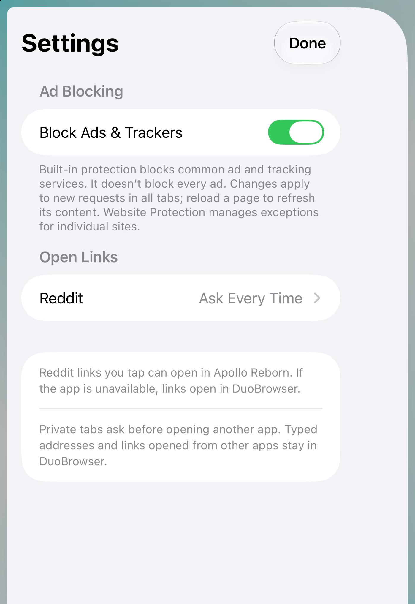

# Reddit links and Settings review

November 11, 2026. Xcode 27.2 / iOS 27.2 SDK, iOS 27.1 deployment target and Duo simulator. No signed-device or TestFlight release was performed.

## Manual simulator interactions

- Debug `--browser-checks --reddit-preview`: a real Device Hub pointer tap on a synthetic Google-wrapped Reddit comment triggered the production isolated trusted-click check and native chooser. Selected Apollo Reborn, verified `apollo://reddit.com/r/swift/comments/abc123/title/def456/?context=3` in the synthetic launch receipt, and tapped again with no repeated chooser. The form draft remained visible. Only installed-app availability and the OS open call were substituted; the actual Apollo app was not installed.
- Ordinary app: skipped setup, opened Page options → Settings, turned Block Ads & Trackers off and back on, opened Reddit preferences, verified Apollo Reborn was disabled as unavailable, selected Ask Every Time, and verified that value in Settings.
- Folded the Settings sheet through closed, open and partially open Duo poses, then rotated the closed display and returned to portrait. Native controls remained reachable and the preference persisted across layout transitions. The rotated form scrolls to its remaining explanatory text.
- Accessibility tree exposed the switch state, disabled app option, chooser actions and selected preference. Full spoken VoiceOver, large-text extremes, hardware touch, energy, pinch/keyboard coexistence and system-occlusion changes were not manually tested in this pass.

The full behavior, source references and known client limitations are in [the implementation notes](../../REDDIT_LINKS_AND_BLOCKING.md). Extension hosting is research only; see [Safari extensions](../../SAFARI_EXTENSIONS.md).

## Review findings addressed

A second agent reviewed the changes after researching extensions. Scripted link activation was hardened with a fixed, isolated-world trusted-click gate; Reader now inherits the global blocking preference; Settings refreshes installed-app availability on foreground notification. Popup initialization removes inherited copies of the trusted-click script before adding one per tab, with a native regression assertion.

The scroll-preservation test now waits for the requested scroll position and allows less than two CSS pixels of rounding, matching the existing native suite's scroll tolerances. This avoids comparing an in-flight scroll with its settled position while still checking that the source page remains in place.

## Automated results

- Debug and Release simulator builds passed. The expected iOS 27 `canOpenURL` deprecation is documented; no new concurrency warning remains.
- 192 portable assertions, 177 browser assertions, zero SwiftLint violations, repository and diff checks passed.
- Full final native run: setup 23, Reddit 25, tab-stack 18, core 93, upgrades 63, settling 34, persistent-cookie write/read 2 each, memory 13. Global blocking tests exercise real synthetic network requests; Reader inheritance and one trusted-click script per popup are included.
- All runs use synthetic fixtures and isolated test storage. Ignored local logs: `work/reddit-build.log`, `work/reddit-release-build.log`, `work/reddit-checks.log`, `work/reddit-web-tests.log`, `work/reddit-lint.log`, `work/reddit-native-final.log`.
