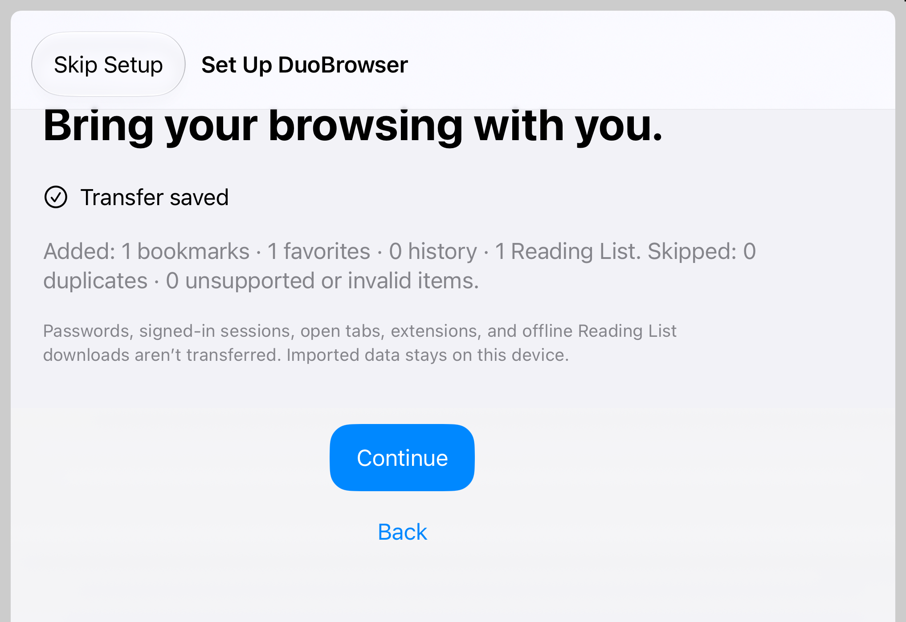

# Guided setup verification — November 11, 2026

## Result

Optional first-run setup and Page options reentry work in the iOS 27.1 Duo simulator. The production transport is BrowserKit direct transfer with file support disabled. Apple's managed Default Web Browser capability is not yet assigned: the request was submitted as Y9UACWK77A, and signed provisioning still refuses it. No real Safari data was accessed, and no new distribution was performed.

## Automated verification

- Debug and Release simulator builds: passed with Xcode 27.2, retaining the iOS 27.1 deployment target. Existing native-harness compiler warnings and App Intents metadata notice remain; no new application compiler warnings were emitted.
- Portable checks: 148 assertions, including 33 import assertions and 33 archive/data assertions.
- Browser/DOM fixtures: 167 assertions.
- Strict SwiftLint: zero violations.
- Complete native suite: 23 setup, 24 tabs/zoom, 93 core, 55 upgrades, 34 camera settling, 4 cookie persistence, and 13 memory assertions.
- The focused setup suite was run again after the final UI changes. Test transport is injected only by the Debug native harness. Release uses the actual BrowserKit manager.

The setup checks exercise invalid activity tokens, private-session rejection, missing capability, pending progress/preferences, review-before-save, an undated Reading List item, duplicate saves and tokens, canceled/stale async work, stream failure, a rejected file response, failed durable writes and staged-data cleanup. Portable checks cover category combinations, hierarchy, localized Favorites folder selection, empty folders, repeat-import deduplication, invalid URLs/dates, cycles, missing parents, size/capacity bounds, legacy loading and persistence.

## Interactive simulator checks

Device Hub accessibility actions exercised Welcome → Transfer → Default Browser → Tour → Start Browsing, Skip Setup and Page options reentry. A History toggle persisted across partially open/open/closed poses and a process relaunch. Rotation preserved the active step. Light/dark appearance and maximum accessibility text were inspected; the first large-text footer consumed too much height and was corrected to scroll with content at accessibility sizes. The final import confirmation is the primary footer action; skipping is secondary.

The Debug `--browser-checks --setup-preview` scenario uses only example.com records and an injected transport. The actual review UI was used to select the Favorites folder, deselect History, and confirm the import. The resulting counts were one bookmark, one favorite, zero history entries and one Reading List entry. This validates UI selection/persistence behavior, not Safari/system transfer eligibility.

## Remaining checks

Apple approval, signed-device Safari source/category sheets, actual bookmark/profile metadata, cold/warm system transfer return, and the system default-browser picker remain unverified. Physical touch/frame pacing/energy, spoken VoiceOver, live system occlusion, and page pinch/keyboard interaction while a real system transfer is active remain device acceptance work. The walkthrough itself has no keyboard input. Existing automated browser and Reduce Motion regressions pass; they do not replace these device checks.

The newly created QA simulator initially stalled host tools during startup. It recovered after restarting that test simulator, and the complete suite subsequently passed. No existing browsing data was used or deleted.

## PR review follow-up

Copilot identified two valid issues: distinct same-named source folders could share a destination, and throwing file-protection updates after the primary archive commit could report a failed import that was already on disk. Folder matching now claims each existing destination once per transfer and never treats newly created folders as candidates for another source folder. Archive writes now apply protection through the atomic Data write options, with no throwing work after the primary commit.

Five additional import assertions cover same-named siblings, nested folders, matching URLs, Favorites isolation, repeat imports and one-to-one matching to an existing folder. Four additional archive assertions exercise backup and primary write failures and recovery without imported data. The iOS harness includes device-only protection-class assertions; the simulator returns no NSFileProtectionKey, so those assertions require hardware. The focused simulator setup suite still has 23 checks.

The initial GitHub CI run failed during hosted simulator startup (data migration failure followed by fixture readiness timeout), before any native assertions ran. Debug/Release compilation and the repository/layout jobs passed on that run; the updated head requires a fresh complete CI pass before merge.
