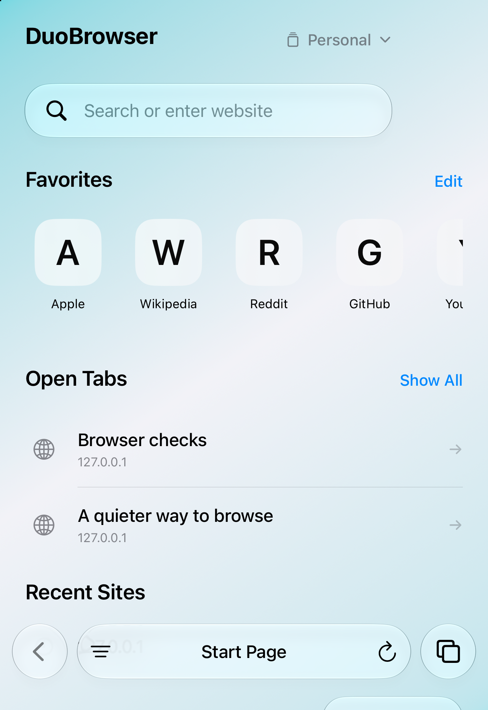
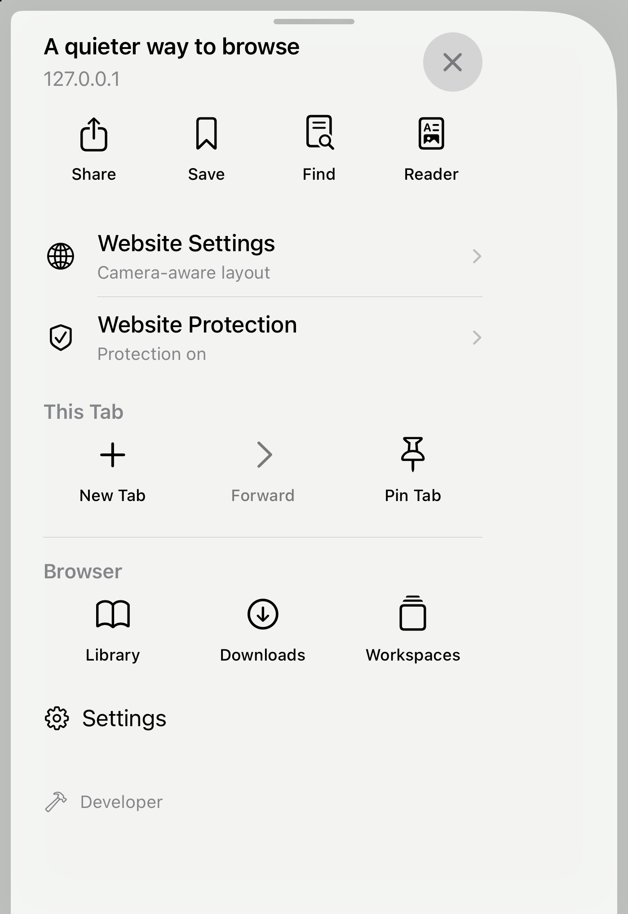
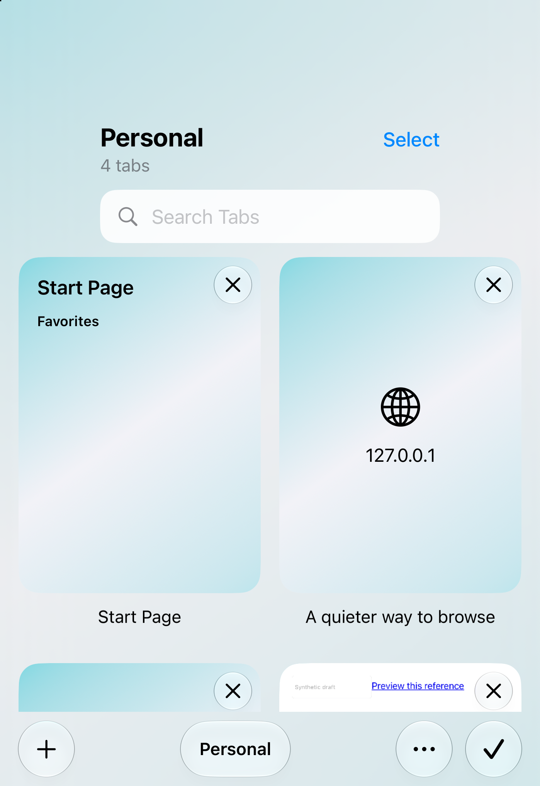
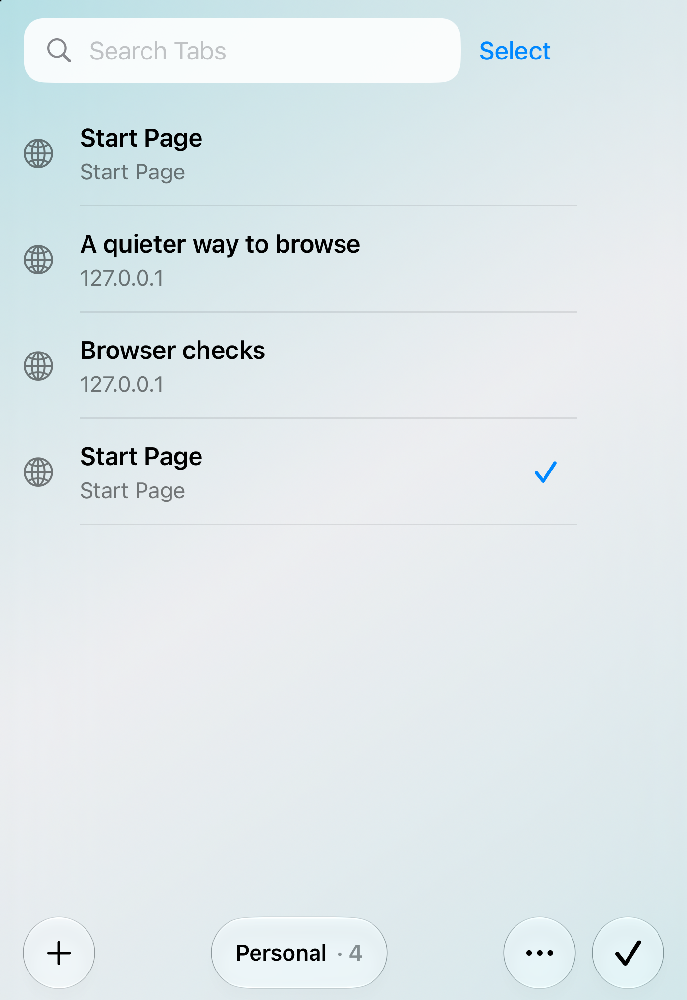
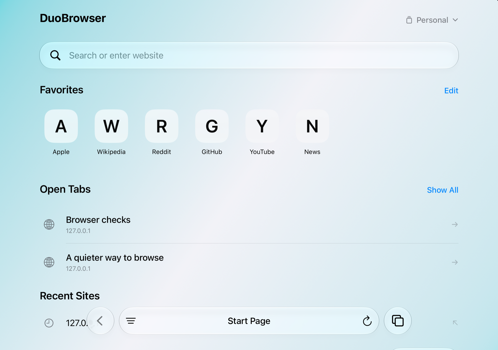

# Daily browsing and native polish

[PR #26](https://github.com/cnichols1734/DuoBrowser/pull/26) combines tab interactions, Page options, a redesigned start page, simple recovery, extension compatibility guidance, and native polish. The owner authorized an in-place installation on the connected phone before any TestFlight decision. No merge or TestFlight upload is included.

## Delivered behavior

- **Tabs:** finger-following adjacent-tab previews retain the current live page. Commitment selects the existing neighbor; cancellation, a second/opposite drag, interruption, folding, rotation and Reduce Motion restore a valid presentation. Search updates when private pages rename themselves. Grid/List, pinned-first reordering, multi-select Move/Close and durable-write rollback are included. A selected-tab move writes its final selection and workspace membership atomically, then changes the live selection only after success. Scope guards keep private and other-workspace selections separate.
- **Page options:** a native controls sheet groups Share, Save, Find and Reader, website controls, tab actions and browser destinations. It now opens at the large detent with tighter regular-text spacing and preserved accessible targets. Follow-up presentation waits for dismissal and validates the originating tab/document. SF typography and the existing Liquid Glass toolbar remain.
- **Start page:** workspace switching, direct search, an editable Favorites ribbon and existing-tab continuation replace the previous repeated grids. Sections are configurable; Recent Sites is optional and cached on data changes. Favorites preserve bookmark identity, folder and date, and removal retains the Library bookmark. Private starts omit normal browsing surfaces and icon requests. A single-child layout measures full and wrapped widths independently to clear runtime occlusions, with bounded retries, RTL placement and a reversible fallback.
- **Recovery:** concise local messages keep usable pages visible and offer explicit failure-scoped actions. Retry validates the original HTTP(S) address and permits GET/HEAD only; no failed POST is replayed and TLS checks remain intact. Opening a saved copy preserves the source failure for return. Generic notices, including scheduled/background archive-write errors, retain typed recovery and appear as secondary text; a successful save removes only its warning. Explicit dismissal and navigation still clear recovery. Oversized notices scroll while browser controls remain reachable.
- **Owner-feedback compactness:** the regular tab overview uses one search/Select row, with workspace identity and count in the footer. The start page reduces its top gap, heading size and regular spacing while retaining local runtime occlusion clearance. Accessibility sizes retain expanded layouts. These changes address the owner’s phone feedback. The grid uses a stationary clipped viewport; live simulator inspection kept the header visible after repeated pull-down bounce. Intermittent native screenshot omission did not match the live display or measured hit geometry, so no established rendering root cause is claimed.
- **New Tab → Tabs:** the owner reported that the switcher stopped responding until relaunch. The presenter now reconciles from UIKit’s actual presentation state and uses a cross-dissolve when the live tab changed inside the presented browser or the matched thumbnail is unavailable. Repeated Tabs requests can retry reconciliation. Production native regressions and interactive simulator inspection exercised New Tab from the live browser, overview and Page options, then returned to the switcher. Latest-source phone acceptance is pending.
- **Secondary surfaces:** Settings, Downloads, Website Data, Website Protection and Library receive consistent navigation, accessible targets, loading/empty/cancellation states and focus restoration. Website Data uses the public callback enumeration API and preserves the original deletion-type selections and privacy boundaries.

Reader extraction/rendering and page-layout JavaScript are unchanged. This change adds no two-page mode, separate-login profiles or private-tab lock.

## Extension compatibility

This change does not install or host Safari extensions. Public WebKit APIs can host compatible accessible packages, but the inspected SDK provides no supported way to enumerate/extract arbitrary installed Safari extension bundles or their private settings. Safari transfer and default-browser approval do not supply those packages.

Other Blocking Apps links to official setup instructions for the owner's named products: AdBlock Pro, Adblock Plus, AdGuard, 1Blocker and Wipr. Some vendors separately offer DNS, network-tracker or system URL filtering that may affect ordinary DuoBrowser traffic after the user enables it. Those routes are distinct from loading a Safari extension and do not imply equivalent cosmetic filtering, automatic detection/import or verified device compatibility. The [ten-product evidence matrix](../2026-11-14-premium-controls/extension-compatibility.md) records each route and its limits. Built-in maintained EasyList/EasyPrivacy protection remains available independently.

## Verification and delivery status

| Check | Completed result |
| --- | --- |
| Full synthetic iOS 27.1 Duo native suite | **690 assertions passed across all 12 batches** on the final feedback source |
| Premium regressions in that full run | **172 assertions passed**, including atomic move persistence, production New Tab/switcher cycles, recovery and seven density assertions |
| Embedded density checks | **7 rendered assertions passed**, including positive scroll, negative overscroll, return, header allocation and hit coverage |
| Portable policies and persistence | **392 checks passed** |
| Web/layout fixtures | **197 assertions passed** |
| SwiftLint 0.65.1 | Strict lint passed |
| Builds | Final feedback Debug simulator and signed-device Release builds passed |
| Hosted CI and Copilot review | Prior committed checkpoint passed CI; latest feedback CI and Copilot review are tracked on PR #26 |

The 690-assertion run includes Premium172, Downloads49, Settings50, Setup37, Reddit29, TabStack40, Core93, Upgrades160, Camera42, cookie write2/read3 and Memory13. It covers live page/draft preservation, interrupted/opposite swipes, stale actions, atomic selected-tab moves and failed writes, private isolation, recovery/copy return, rendered occlusion nonintersection, wrapping convergence and RTL/intrinsic alignment. All seven rendered density checks passed in the full run. Live simulator inspection also verified the compact grid after repeated bounce, a New Tab → Tabs return with five tabs, maximum-text search/selection/footer layout, and closed/open start pages. Text size and the closed portrait pose were restored. The [density review](../2026-11-14-compact-density/README.md) distinguishes the live result from the intermittent native capture omission.

The camera font assertion now compares the measured pre-fit and post-fit WebKit font. On the open-display QA pose, the computed font was **21px before and after fitting**; the previous literal 18px expectation rejected unchanged platform sizing. No production page-layout JavaScript or fixture CSS changed, and no assertions were removed.

The default local run includes Downloads49; hosted CI retains the owner-approved download omission. Final hosted CI/Copilot results and exact-source phone launch status are tracked on [PR #26](https://github.com/cnichols1734/DuoBrowser/pull/26).

Closed-display simulator captures below use synthetic sites; Favorites deliberately show letter fallbacks. Maximum text, dark appearance, Reduce Motion and the VoiceOver-enabled partially folded interface also received simulator accessibility inspection. Scratch receipts, signing profiles and device identifiers remain under ignored `work/`.

Interactive simulator inspection exercised navigation recovery, address editing, Page options, native Find (nine matches), Share presentation/dismissal, tab search, Grid/List, accessible reordering, batch workspace movement, bulk-close cancellation and start-page customization. Follow-up manual flows also created a tab through Page options and the overview, then tapped Tabs again successfully; rapid/repeated requests are covered by the production presentation regression. Display transitions included closed, open, partially folded and rotation. VoiceOver's system onboarding required dismissal; this was an interface inspection, not full spoken navigation acceptance.

For comparison, the repository retains the [previous mixed Page menu](../2026-11-12-downloads/before-menu.png) and [previous tab overview](../../images/tab-overview-2026-11-08.png). Those are historical synthetic captures with different display poses/fixtures, not controlled pixel comparisons.

The refreshed closed-display captures show the compact feedback pass; the grid capture follows a manual pull-down bounce. The following before/after captures document layout changes; they are simulator development evidence, not physical-device acceptance.

| Before compact start page | Compact start page |
| --- | --- |
|  |  |

| Before compact Page options | Compact Page options |
| --- | --- |
|  |  |

| Before compact tab overview | Compact tab overview |
| --- | --- |
|  |  |

The refreshed open-display start page also shows the compact density pass. Its documentation image is resized below the repository’s 5 MiB file limit; the original remains in ignored scratch space.

The signed development build **1.0.1 (13)** containing the compact layouts, New Tab/switcher follow-up and atomic move-selection fix is installed in place on the connected Duo as `dev.cnichols.duobrowser`, with no uninstall. Signature, team, target-device profile, version, minimum OS, Photos purpose string and disabled default-browser entitlement passed preflight. iOS refused the launch attempt because the phone locked again; the owner has been asked to unlock it. Exact source/artifact provenance and final launch receipts are retained under ignored `work/device/`; final launch status is tracked on PR #26.

The owner’s supplied Photos crash came from **1.0.1 (12)** and identified the missing `NSPhotoLibraryAddUsageDescription` purpose string. That metadata was already corrected in build 13 and is present in the installed app; the older crash does not establish a new build-13 defect. Actual normal/private photo-save Allow/Don’t Allow interactions remain hardware acceptance work. See the [November 12 correction record](../../ROADMAP.md).

Physical touch/frame pacing, battery/endurance, full spoken VoiceOver, signed credentials/passkeys, third-party system filters and actual Safari transfer remain separate hardware checks. Simulator results do not establish those outcomes. Merge and TestFlight remain owner-controlled later steps.
